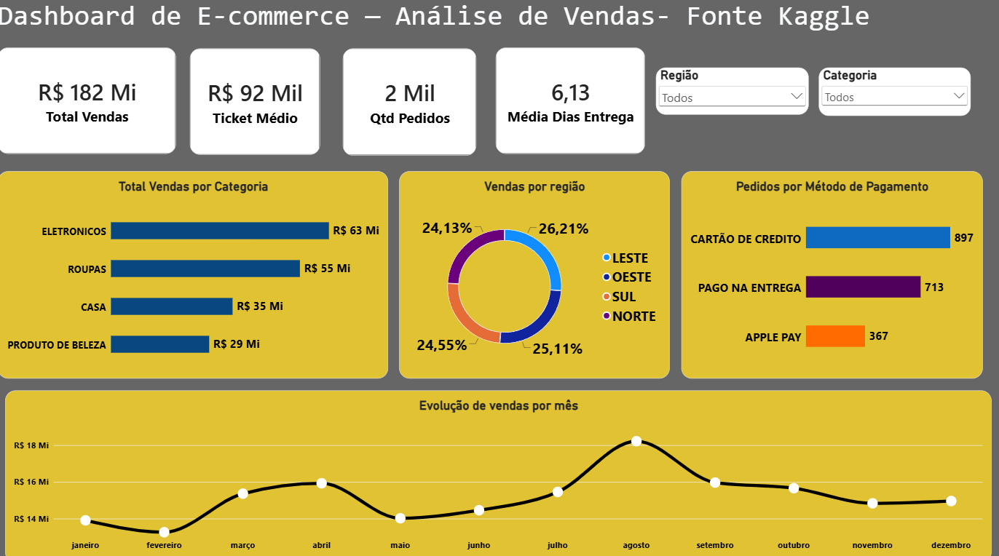

# 📊 Portfólio de Projetos — Business Intelligence

Portfólio com projetos de análise de dados usando Python, Pandas e Power BI.
## 🖼 Painel de Controle

---
## 🚀 Projetos

### 🤖 Automação de Análise — Olist E-commerce (Python)

Pipeline em Python que lê, trata e consolida 5 CSVs do dataset público da Olist, gera análises de negócio e exporta para Excel — rodando automaticamente todos os dias.

**Stack:** Python · Pandas · Agendador de Tarefas do Windows

📂 [Ver projeto](./python-automacao)

---

## 🛠 Stack geral

Python · Pandas · Power BI · Power Query · DAX

## 🔗 Contato

- GitHub: [@carlosaurujo777](https://github.com/carlosaurujo777)
