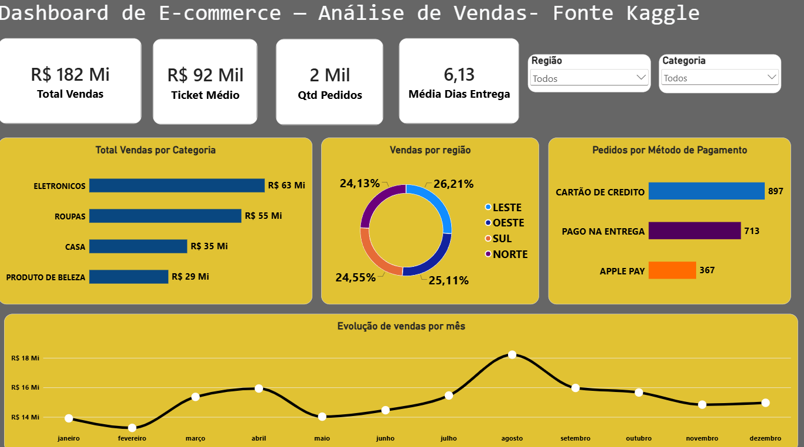

# 👋 E aí, eu sou o Carlos Alexandre!

Buscando oportunidades como Analista de Dados Júnior ou Desenvolvedor Web Júnior, preferencialmente remoto.

Atuo unindo a lógica de programação (Python, Web) com a inteligência de negócios (Power BI, SQL). Já passei por ambientes públicos, corporativos e hospitalares, sempre focado em organização de dados, sistemas internos e criação de dashboards.

Tenho uma mente curiosa, gosto de experimentar tecnologias e transformar ideias em projetos funcionais. Quando não estou resolvendo problemas de dados, estou construindo interfaces interativas e brincando com a cultura hacker.

- 🎯 **Buscando:** Oportunidades como Analista de Dados Júnior/Pleno ou Desenvolvedor Júnior (Remoto).
- 🌱 **Estudando agora:** Estruturas de dados, React (futuramente) e Indie Hacking.
- ⚡ **Curiosidade:** Meu hiperfoco já me fez criar um portfólio inteiro em formato de terminal do Matrix do zero.

## 🛠️ Tecnologias e Competências

**Análise de Dados & BI:**

**Desenvolvimento & Web:**

**Ferramentas:**

---

## 🚀 Meus Projetos em Destaque

### 🟢 [Matrix OS](https://carlosaraujo777.github.io/matrix-portfolio/)
Portfólio interativo construído do zero com Vanilla JS. Possui chuva de código (Canvas API), escolha de pílulas (vermelha/azul) e um terminal com comandos reais, autocomplete e histórico.
*Tech: HTML, CSS, JavaScript, Canvas API.*

### 🖥️ [System Terminal (Fake Hacker CTF)](https://carlosaraujo777.github.io/system-terminal/)
Simulador de terminal hacker com 3 missões lógicas, efeitos sonoros gerados via Web Audio API e uma trolagem clássica de carregamento que trava no 99%.
*Tech: HTML, CSS, JavaScript.*

### 📈 Dashboard de E-commerce (Power BI)
Dashboard com análise de vendas por categoria, região, método de pagamento e evolução mensal, com KPIs e insights.
*Tech: Power BI, Power Query, DAX.*

---

## 💼 Experiência
- **SEAF – Secretaria de Agricultura Familiar** — Análise de dados e sistemas (2025–2026)
- **MAPA – Ministério da Agricultura e Pecuária** — Estágio em rotinas administrativas e dados (2023–2024)
- **Agropecuária Scheffer** — Menor Aprendiz (2021–2023)

## 🎓 Formação
- **Tecnologia em Agrocomputação** — FATEC Cuiabá (Concluído)
- **Power BI Avançado com IA** — Senac Quantum (Em andamento)

---

## 🔗 Vamos conversar?

---
*"Eu vou vencer, nem que seja um segundo de cada vez."* 🚀
